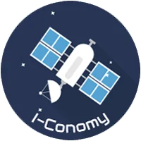
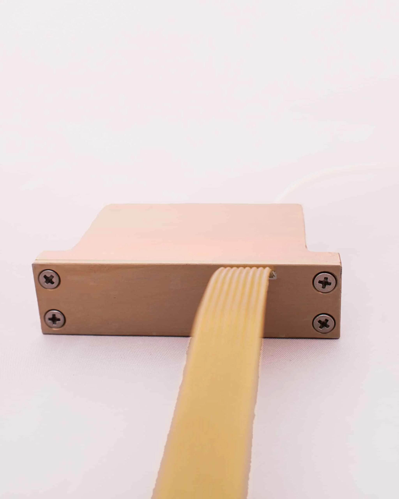
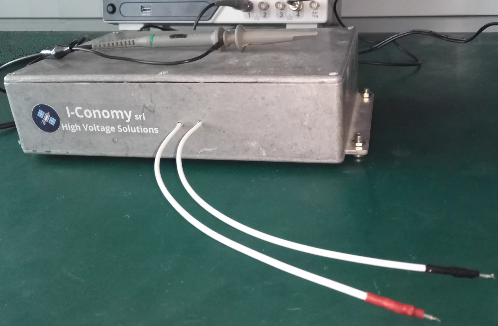
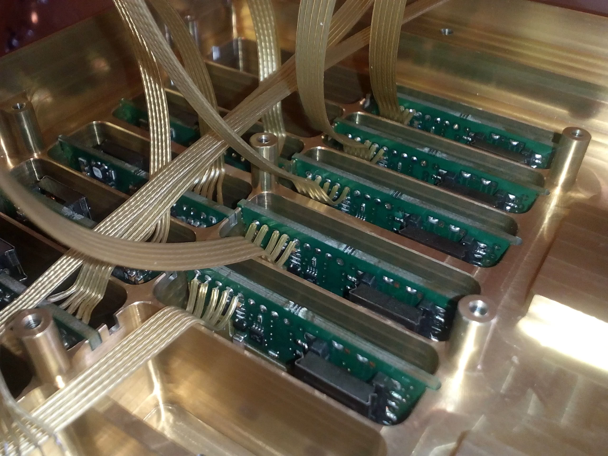

  

<h1 align="center">I-Conomy — High Voltage Solutions for Space</h1>

  <strong>ITAR-free high voltage DC/DC converters, from ±150 V to ±6000 V.</strong> 
  Designed and built in Italy. Flying in orbit since 2018.

  <a href="https://i-conomy.com/"><strong>🌐 i-conomy.com</strong></a>
  &nbsp;·&nbsp; <a href="https://i-conomy.com/modules/index.html">Product catalogue</a>
  &nbsp;·&nbsp; <a href="https://i-conomy.com/technical-manual.html">Request a technical manual</a>
  &nbsp;·&nbsp; <a href="https://i-conomy.com/contact.html">Contact</a>

  <a href="https://i-conomy.com/zh/">中文</a> ·
  <a href="https://i-conomy.com/ru/">Русский</a> ·
  <a href="https://i-conomy.com/ja/">日本語</a> ·
  <a href="https://i-conomy.com/ko/">한국어</a> ·
  <a href="https://i-conomy.com/pl/">Polski</a>

  

---

## Why engineers choose I-Conomy

Making a high voltage power supply is not difficult. Making one that works **for years in space, in any vacuum condition, free of US export restrictions** is another matter — and that is the only thing we do.

| | |
|---|---|
| 🛰️ **3,000+ flight models** delivered | ✅ **100% mission success** |
| 🇪🇺 **ITAR-free** by design — European supply chain | ☢️ **Radiation tested** — Total Dose up to 30 krad |
| 🌌 **Guaranteed in vacuum** — no corona, no discharge from outgassing | 🔧 **30+ years** of internal R&D (Aerospazio Tecnologie spin-off) |

---

## Products

<table>
  <tr>
    <td width="33%" valign="top">
      
      <h3><a href="https://i-conomy.com/modules/single-channel.html">HV3 Single Channel Modules</a></h3>
      Off-the-shelf DC/DC converters from <b>±150 V to ±6000 V</b>, +12 V input, positive or negative output.
      For photomultipliers (PMT), APD, SiPM and silicon detectors.
    </td>
    <td width="33%" valign="top">
      
      <h3><a href="https://i-conomy.com/modules/piezoelectric.html">Piezoelectric Actuator Drivers</a></h3>
      Four-quadrant, very low noise HV supplies from <b>−700 V to +700 V</b>, capacitive loads up to 25 nF.
      They both source and sink current.
    </td>
    <td width="33%" valign="top">
      
      <h3><a href="https://i-conomy.com/modules/custom-systems.html">Custom HV Systems</a></h3>
      Complete systems built to your specification: machined housing, control board, HV modules and cables,
      optimised for weight and size.
    </td>
  </tr>
</table>

Need a voltage or current that is not in the catalogue? **[Send us your mission profile](https://i-conomy.com/contact.html)** — output voltage, current, load and environment — and we will answer with a part number or a custom proposal.

---

## Flight heritage

| Mission | Hardware supplied | Status |
|---|---|---|
| **CSES-01** — China Seismo-Electromagnetic Satellite | 62 × HV3 −1200 V, 14 HV dividers, 12 × HV3 +150 V | 🟢 In orbit since Feb 2018 |
| **CSES-02** | 80 flight modules for photomultipliers | Delivered |
| **IBIS 2.0** — INAF, Rome | 3 × four-quadrant ±700 V systems | Operating |
| **Beijing Conveyi** | HV3 ±3000 V, 150 µA | Delivered |

Trusted by the Italian Space Agency (ASI), INFN, INAF, CNR and Italian universities, and by Chinese partners including CNSA, IHEP and NSSC. **[See all missions →](https://i-conomy.com/heritage.html)**

---

## Get in touch

  📧 <a href="mailto:info@i-conomy.com">info@i-conomy.com</a> &nbsp;·&nbsp;
  📍 Livorno, Italy

  <a href="https://i-conomy.com/quote.html"><b>Request a quote</b></a> ·
  <a href="https://i-conomy.com/technical-manual.html"><b>Request a technical manual</b></a>

I-Conomy S.r.l. — spin-off of Aerospazio Tecnologie · VAT IT01297340521 
This repository hosts the source of the website <a href="https://i-conomy.com/">i-conomy.com</a>. © I-Conomy S.r.l. — all rights reserved.
